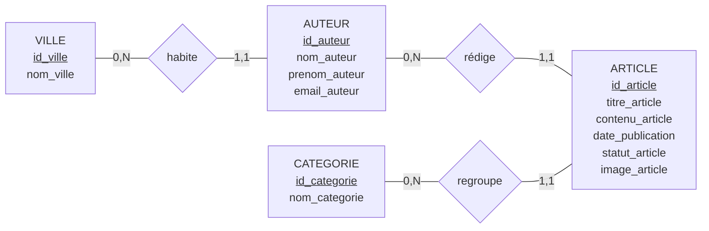

# Blog — Modèle Conceptuel de Données (MCD)

## 1. Présentation

Ce document présente le Modèle Conceptuel de Données (MCD) de l'application Blog, réalisé selon la méthode Merise.

Il regroupe les quatre entités, leurs attributs, leurs identifiants ainsi que les trois relations et leurs cardinalités.

## 2. Diagramme MCD

## 3. Description des entités

### VILLE
- **Identifiant :** id_ville
- nom_ville

### AUTEUR
- **Identifiant :** id_auteur
- nom_auteur
- prenom_auteur
- email_auteur

### ARTICLE
- **Identifiant :** id_article
- titre_article
- contenu_article
- date_publication
- statut_article
- image_article

### CATEGORIE
- **Identifiant :** id_categorie
- nom_categorie

## 4. Relations et cardinalités

| Relation | Entité A | Cardinalité A | Entité B | Cardinalité B |
|:---|:---|:---:|:---|:---:|
| habite | VILLE | (0,N) | AUTEUR | (1,1) |
| rédige | AUTEUR | (0,N) | ARTICLE | (1,1) |
| regroupe | CATEGORIE | (0,N) | ARTICLE | (1,1) |

## 5. Règles de gestion

**RG01 — Habite**

Une ville peut accueillir zéro ou plusieurs auteurs. Un auteur habite obligatoirement dans une seule ville.

**RG02 — Rédige**

Un auteur peut rédiger zéro ou plusieurs articles. Chaque article est rédigé par un seul auteur.

**RG03 — Regroupe**

Une catégorie peut regrouper zéro ou plusieurs articles. Chaque article appartient obligatoirement à une seule catégorie.

## 6. Vérification du modèle

- [x] Les quatre entités sont présentes.
- [x] Tous les attributs sont définis.
- [x] Chaque entité possède un identifiant.
- [x] Les trois relations sont correctement définies.
- [x] Les cardinalités respectent les résultats validés.
- [x] L'attribut calculé `duree_lecture` est absent.
- [x] Aucune nouvelle entité ou relation n'a été ajoutée.

## 7. Conclusion

Le MCD du Blog est maintenant assemblé conformément à la méthode Merise.

Ce modèle constitue la base de la prochaine étape : la transformation du Modèle Conceptuel de Données (MCD) en Modèle Logique de Données (MLD).
